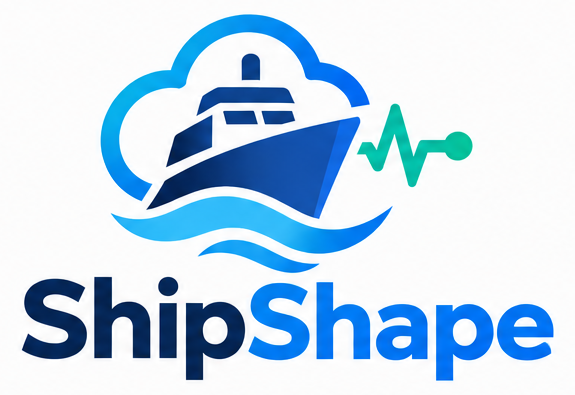

<p align="center">
  <picture>
    <source media="(prefers-color-scheme: dark)" srcset="docs/assets/shipshape-logo-dark.png" />
    
  </picture>
</p>

<h3 align="center">Monitor. Deploy. Stay ShipShape.</h3>

<p align="center">
  A developer platform that monitors HTTP services, detects incidents, and answers one question:<br/>
  <strong>“Did this deploy cause this outage?”</strong>
</p>

<p align="center">
  
  
  
  
  
</p>

---

> **Status:** Active development.
> Features below are marked ✅ implemented, 🚧 in progress, or ⏳ planned. Nothing is labelled done until it is implemented **and** covered by tests.

## Table of contents

- [Why I built this](#why-i-built-this)
- [Why ShipShape](#why-shipshape)
- [Features](#features)
- [Architecture](#architecture)
- [Tech stack](#tech-stack)
- [Getting started](#getting-started)
- [Running tests](#running-tests)
- [Project structure](#project-structure)
- [Security](#security)
- [Deployment](#deployment)
- [Roadmap](#roadmap)
- [Known limitations](#known-limitations)
- [Author](#author)

## Why I built this

After leading development on AU Connect, a university platform deployed at life.au.edu, I learned that shipping is only half the job. Once real users depend on it, the questions change: *Is it up? Is it slow? And if something broke, was it the release we just pushed?* ShipShape is the tool I wanted for that: one place that watches your services and connects outages to the deploys that preceded them.

## Why ShipShape

Most outages start with a change. Uptime monitors tell you *that* something broke, and CI/CD tools tell you *what* shipped, but they rarely talk to each other. ShipShape puts both in one place:

1. **Monitor** your HTTP endpoints on a schedule.
2. **Detect** incidents when checks fail repeatedly, and resolve them when the service recovers.
3. **Correlate** each incident with deployments that happened shortly before it, and explain *why* each deploy is a suspect.

## Features

| Feature | Status |
| --- | --- |
| Account registration and login (session cookies, CSRF protection) | ⏳ |
| Projects and monitors with per-user ownership checks | ⏳ |
| Scheduled HTTP checks with connect/read timeouts | ⏳ |
| SSRF protection (blocks private, loopback, link-local and cloud-metadata addresses after DNS resolution) | ⏳ |
| Incident detection (open after N consecutive failures, resolve after M successes) | ⏳ |
| Deployment ingest API with per-project API tokens (hashed, shown once) | ⏳ |
| Incident ↔ deployment correlation with match explanations | ⏳ |
| Dashboard: latency and uptime charts, incident timeline with deploy markers | ⏳ |
| CI/CD: GitHub Actions → GHCR images | ⏳ |
| Infrastructure as code: Terraform on AWS EC2 | ⏳ |
| Dogfooding: ShipShape reports its own deploys to itself | ⏳ |

## Architecture

ShipShape is a **modular monolith**: one deployable Spring Boot application split into business modules with boundaries enforced by [Spring Modulith](https://spring.io/projects/spring-modulith) tests.

```
                ┌───────────────────────────────────────────────┐
  Browser ────▶ │  React + TypeScript SPA (Vite, TanStack Query) │
                └───────────────────────┬───────────────────────┘
                                        │ JSON over HTTPS (session cookie + CSRF)
                ┌───────────────────────▼───────────────────────┐
                │           Spring Boot modular monolith         │
                │                                                │
                │  identity ─ monitoring ─ incidents ─ deployments│
                │      │           │            │           │     │
                └──────┼───────────┼────────────┼───────────┼─────┘
                       └───────────┴─────┬──────┴───────────┘
                                         ▼
                               PostgreSQL (Flyway)
                                         ▲
  CI pipeline ── POST /api/deployments ──┘   (API token)
```

| Module | Responsibility |
| --- | --- |
| `identity` | Users, authentication, sessions |
| `monitoring` | Monitors, scheduler, HTTP checker, check results |
| `incidents` | Incident detection and lifecycle |
| `deployments` | Deploy ingest, API tokens, correlation |

**Why not microservices?** Each module talks to the others through a narrow public API, so if monitoring ever needed to scale on its own, the module boundary is already the seam to split along. Until then, a single process avoids network calls, distributed transactions and extra infrastructure cost.

## Tech stack

**Backend:** Java 21, Spring Boot, Spring Security (session cookies), Spring Data JPA, Spring Modulith, PostgreSQL, Flyway
**Frontend:** React, TypeScript, Vite, Tailwind CSS, TanStack Query, Recharts
**Testing:** JUnit 5, Testcontainers, WireMock, Vitest
**DevOps:** Docker Compose, GitHub Actions, GitHub Container Registry, Terraform, AWS EC2

## Getting started

### Prerequisites

- Java 21
- Node.js (LTS) and npm
- A Docker runtime (Docker Desktop, OrbStack or Colima)

### 1. Start the database

```bash
docker compose up -d db
```

### 2. Run the backend

```bash
cd backend
./mvnw spring-boot:run        # or ./gradlew bootRun
```

Check it is up:

```bash
curl http://localhost:8080/actuator/health
# {"status":"UP"}
```

### 3. Run the frontend

```bash
cd frontend
npm install
npm run dev
```

The app runs at http://localhost:5173.

> Local credentials in `docker-compose.yml` are for development only. Production secrets are stored in AWS SSM Parameter Store and are never committed.

## Running tests

```bash
# Backend: unit + integration tests (Testcontainers starts its own PostgreSQL)
cd backend && ./mvnw test

# Frontend
cd frontend && npm test
```

Backend tests do **not** depend on the Compose database; they are self-contained.

## Project structure

```
shipshape/
├── backend/            Spring Boot application
│   └── src/main/java/com/shipshape/
│       ├── identity/
│       ├── monitoring/
│       ├── incidents/
│       ├── deployments/
│       └── shared/
├── frontend/           React + TypeScript SPA
├── infra/              Terraform for AWS
├── docs/               Architecture notes and assets
└── docker-compose.yml
```

## Security

Security decisions are documented here as they are implemented:

- **Ownership checks:** every query for a project, monitor, incident or deployment is scoped to the current user; requests for another user's resources return `404`, not `403`, to avoid leaking existence.
- **SSRF protection:** monitors accept user-supplied URLs, so the checker resolves DNS first and rejects private, loopback, link-local and metadata (`169.254.169.254`) addresses, including after redirects.
- **API tokens:** deploy-ingest tokens are random, stored only as hashes, and shown to the user once.
- **Sessions:** HTTP-only, `SameSite` session cookies with CSRF protection for state-changing requests.
- **Secrets:** no secrets in the repository; production values come from AWS SSM Parameter Store.

## Deployment

ShipShape is built and tested locally, then deployed to AWS only when needed, to keep costs low.

1. GitHub Actions runs the test suites and pushes Docker images to GHCR.
2. Terraform provisions an EC2 instance, security group and IAM role.
3. The instance runs the application with Docker Compose.
4. `terraform destroy` tears everything down when the environment is idle.

## Roadmap

The app is built in this order, each step on top of the last:

1. [ ] **Foundations:** project skeleton, database migrations, enforced module boundaries
2. [ ] **Identity:** registration, login, session cookies and CSRF protection
3. [ ] **Projects and monitors:** CRUD with ownership checks on every query
4. [ ] **Monitoring engine:** scheduler, HTTP checker with timeouts, SSRF protection
5. [ ] **Incident detection:** open/resolve state machine, tested against WireMock failure scenarios
6. [ ] **Deployments:** ingest API with hashed per-project API tokens
7. [ ] **Correlation:** link incidents to recent deploys and explain each match
8. [ ] **Dashboard:** latency and uptime charts, incident timeline with deploy markers
9. [ ] **CI/CD:** automated tests and container images on every push
10. [ ] **Cloud deployment:** Terraform-managed AWS infrastructure, with ShipShape reporting its own deploys

## Known limitations

This section will be kept honest as the project develops. Current design trade-offs:

- Single-instance scheduler: checks run inside one application instance, so horizontal scaling would need distributed locking or a dedicated worker.
- Correlation is time-window based and explains its matches; it suggests suspects, it does not prove causation.
- Single-region checks: a network problem between the checker and a service can look like an outage.

## Author

**Thant Zin Min (Tommy)** — Computer Science, Assumption University, Bangkok

- Portfolio: [thantzinmin.tech](https://thantzinmin.tech)
- GitHub: [@Tommyzizii](https://github.com/Tommyzizii)
- LinkedIn: [linkedin.com/in/thantzinmin](https://linkedin.com/in/thantzinmin)
